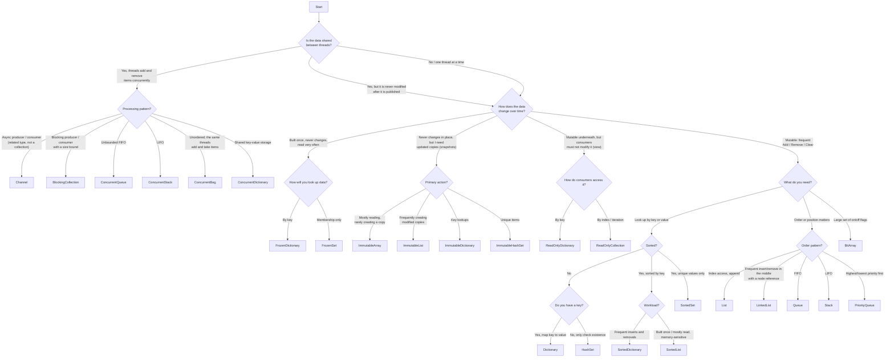

# Practical .NET Collections

A practical, performance-focused guide to choosing the right .NET collection based on behavior, trade-offs, and measured performance.

All benchmark numbers come from [BenchmarkDotNet](https://benchmarkdotnet.org/) runs in [`benchmarks/`](./benchmarks). They depend on hardware, runtime version, and (for concurrency) core count, so treat them as relative indications and re-run them on your own machine. Each page lists the command to do so.

## Benchmark environment

All result tables in `docs/` and their [BenchmarkDotNet GitHub Markdown reports](./BenchmarkDotNet.Artifacts/results/) were generated by the same benchmark run:

- BenchmarkDotNet 0.15.8
- Windows 11 (10.0.26300.9711)
- CPU reported by BenchmarkDotNet as `virt-10.0` at 1.00 GHz, with 1 CPU and 4 logical / 4 physical cores
- .NET SDK 10.0.403; .NET 10.0.14, Arm64 RyuJIT (`armv8.0-a`)
- Job: 3 warmup iterations and 8 measurement iterations

The CPU is reported as a virtualized processor, so these results describe this environment rather than a specific physical CPU model. BenchmarkDotNet's `Error` and `StdDev` columns are retained in each table; use them to judge measurement variability, and treat small differences as inconclusive. Absolute timings can differ on other hardware or runtimes.

To reproduce the full run from the repository root:

```bash
dotnet run --project benchmarks/PracticalDotNetCollections.Benchmarks.csproj -c Release
```

The generated reports include the run environment and are the source for the result tables in `docs/`.

---

## How to use this guide

- **Step 1:** Use the **Decision Flow** below to narrow down your constraints.
- **Step 2:** Use the **Quick Decision Matrix** to confirm the choice.
- **Step 3:** Follow the links to the detailed behavior, trade-offs, and benchmarks.
- Pages under [comparisons](#comparisons), [scenarios](#scenarios), and [advanced topics](#advanced-topics) go deeper on specific questions.

---

## Decision Flow

Decisions are evaluated in this order:
1. **Sharing across threads** (concurrent writers, or read-only sharing?)
2. **Data lifetime** (mutable, built once and never changed, immutable snapshots, or a read-only view?)
3. **Access pattern** (lookup by key/value, or by order/position?)
4. **Ordering requirements** (sorted, prioritized, FIFO, LIFO?)

Frozen and immutable collections are safe to share between threads without locks, so they appear under "Data lifetime" even when several threads read them. Read-only *views* are not thread-safe if the underlying collection is still being modified.



---

## Quick Decision Matrix

| Category | Requirement & behavior | Recommended collection |
| :--- | :--- | :--- |
| **Mutable** | Dynamic list with index access | [`List<T>`](./docs/collections/list.md) |
| **Mutable** | Frequent insert/remove at known nodes | [`LinkedList<T>`](./docs/collections/linkedlist.md) |
| **Mutable** | Key-to-value mapping | [`Dictionary<TKey, TValue>`](./docs/collections/dictionary.md) |
| **Mutable** | Uniqueness and existence checks | [`HashSet<T>`](./docs/collections/hashset.md) |
| **Mutable** | FIFO processing | [`Queue<T>`](./docs/collections/queue.md) |
| **Mutable** | LIFO processing | [`Stack<T>`](./docs/collections/stack.md) |
| **Mutable** | Processing ordered by priority | [`PriorityQueue<TElement, TPriority>`](./docs/collections/priorityqueue.md) |
| **Mutable** | Compact storage of many boolean flags | [`BitArray`](./docs/collections/bitarray.md) |
| **Sorted** | Sorted by key; frequent inserts | [`SortedDictionary<TKey, TValue>`](./docs/collections/sorteddictionary.md) |
| **Sorted** | Sorted by key; built once, mostly read | [`SortedList<TKey, TValue>`](./docs/collections/sortedlist.md) |
| **Sorted** | Sorted unique values | [`SortedSet<T>`](./docs/collections/sortedset.md) |
| **Concurrent** | Shared key-value storage | [`ConcurrentDictionary<TKey, TValue>`](./docs/collections/concurrentdictionary.md) |
| **Concurrent** | Unbounded thread-safe FIFO | [`ConcurrentQueue<T>`](./docs/collections/concurrentqueue.md) |
| **Concurrent** | Unbounded thread-safe LIFO | [`ConcurrentStack<T>`](./docs/collections/concurrentstack.md) |
| **Concurrent** | Unordered pool where threads mostly take back what they added | [`ConcurrentBag<T>`](./docs/collections/concurrentbag.md) |
| **Concurrent** | Blocking, optionally bounded producer-consumer pipeline | [`BlockingCollection<T>`](./docs/collections/blockingcollection.md) |
| **Immutable** | Snapshot optimized for reads | [`ImmutableArray<T>`](./docs/collections/immutablearray.md) |
| **Immutable** | Snapshot optimized for frequent modified copies | [`ImmutableList<T>`](./docs/collections/immutablelist.md) |
| **Immutable** | Snapshot key-value map | [`ImmutableDictionary<TKey, TValue>`](./docs/collections/immutabledictionary.md) |
| **Immutable** | Snapshot set of unique elements | [`ImmutableHashSet<T>`](./docs/collections/immutablehashset.md) |
| **Frozen** | Created once at startup; fastest key lookups | [`FrozenDictionary<TKey, TValue>`](./docs/collections/frozendictionary.md) |
| **Frozen** | Created once at startup; fastest membership checks | [`FrozenSet<T>`](./docs/collections/frozenset.md) |
| **Read-only view** | Unmodifiable view over a list that may still change | [`ReadOnlyCollection<T>`](./docs/collections/readonlycollection.md) |
| **Read-only view** | Unmodifiable view over a dictionary that may still change | [`ReadOnlyDictionary<TKey, TValue>`](./docs/collections/readonlydictionary.md) |
| **Related type** | Async producer-consumer (not a collection) | [`Channel<T>`](./docs/related-types/channel.md) |

Thread safety at a glance: concurrent collections, immutable collections, and frozen collections can be shared across threads (concurrent ones for writes too). `List<T>`, `Dictionary<TKey, TValue>` and the other standard mutable collections, and read-only views over them, are not safe for concurrent modification.

---

## Common Mistakes

- **Using `List<T>.Contains` inside loops:** Each call is a linear scan. Convert the data to a `HashSet<T>` for repeated membership checks.
- **Calling `Add` on `ImmutableArray<T>` in a loop:** Every call copies the whole array. Use `ImmutableArray.CreateBuilder<T>()` and call `ToImmutable()` once.
- **Not providing a capacity hint:** Growing a `List<T>` or `Dictionary<TKey, TValue>` incrementally reallocates and copies. Pass the expected size when it is known.
- **Using struct keys without `IEquatable<T>`:** The default comparer boxes the key on equality checks. Implement `IEquatable<T>` and override `GetHashCode()`. See [struct dictionary keys](./docs/advanced/struct-dictionary-keys.md).
- **Looking up the same dictionary key several times when updating:** `ContainsKey` + get + set is up to four lookups. `TryGetValue` + set is two; `CollectionsMarshal.GetValueRefOrNullRef` (existing keys) or `GetValueRefOrAddDefault` (add or update) is one.
- **Iterating `Dictionary.Keys` and then looking up each value:** Enumerate the `KeyValuePair` entries directly with `foreach (var (key, value) in dict)`.
- **Wrapping a mutable collection in `ReadOnlyCollection<T>` and expecting a snapshot:** The wrapper reflects later changes to the source. For a snapshot use `ToImmutableArray()`, `ToFrozenSet()`, `ToFrozenDictionary()` or copy the data.
- **Assuming `ReadOnlyCollection<T>` protects the elements:** It only blocks adding, removing and replacing items. Mutable element objects can still be changed.
- **Casting to `IEnumerable<T>` to "protect" a collection:** Callers can cast back to `List<T>`. Return a read-only wrapper or an immutable copy instead.
- **Using `ConcurrentBag<T>` for separate producers and consumers:** The bag is optimized for threads that take back what they added; otherwise it falls back to stealing from other threads' lists. Use `ConcurrentQueue<T>` (or `ConcurrentStack<T>`) instead.
- **Using `SortedDictionary` when data is built once and then read:** `SortedList` stores entries in arrays, which uses less memory and iterates faster, but random inserts cost O(n).
- **Allocating closures in `ConcurrentDictionary.GetOrAdd`:** Use the overload that accepts a factory argument, for example `GetOrAdd(key, static (k, arg) => ..., arg)`.
- **Reading `ConcurrentDictionary.Count` on hot paths:** `Count` takes all internal locks. Use `IsEmpty` for emptiness checks; it first scans buckets without taking locks.
- **Using `Dequeue()` then `Enqueue()` on a `PriorityQueue` to replace the top element:** `EnqueueDequeue` and `DequeueEnqueue` do the same work with one sift operation.
- **Using `Queue<T>` or `Stack<T>` when you need to access middle elements:** Use `List<T>` instead.
- **Using `bool[]` or `List<bool>` for very large numbers of flags:** Each `bool` takes a byte. `BitArray` uses one bit per flag, at the cost of slower per-element access.
- **Using `ImmutableList<T>` for a read-mostly snapshot:** It is a tree; index reads are much slower than on an array. Use `ImmutableArray<T>` unless you need cheap modified copies.

---

## Detailed Collections Catalog

### Core Mutable
- [List](./docs/collections/list.md) — Array-backed indexable dynamic list.
- [LinkedList](./docs/collections/linkedlist.md) — Node-based sequence with O(1) insert/remove at a known node.
- [Queue](./docs/collections/queue.md) — First-in, first-out sequence.
- [Stack](./docs/collections/stack.md) — Last-in, first-out sequence.
- [PriorityQueue](./docs/collections/priorityqueue.md) — Dequeues the element with the lowest priority value first.
- [Dictionary](./docs/collections/dictionary.md) — Unique key-to-value hash map.
- [HashSet](./docs/collections/hashset.md) — Hash-based set for membership checks.
- [BitArray](./docs/collections/bitarray.md) — Compact bit-per-flag storage.

### Sorted
- [SortedList](./docs/collections/sortedlist.md) — Sorted key-value arrays; compact, fast reads.
- [SortedDictionary](./docs/collections/sorteddictionary.md) — Sorted key-value tree; cheaper random inserts.
- [SortedSet](./docs/collections/sortedset.md) — Sorted set of unique values.

### Concurrent
- [ConcurrentDictionary](./docs/collections/concurrentdictionary.md) — Shared key-value storage.
- [ConcurrentQueue](./docs/collections/concurrentqueue.md) — Thread-safe FIFO queue.
- [ConcurrentStack](./docs/collections/concurrentstack.md) — Thread-safe LIFO stack.
- [ConcurrentBag](./docs/collections/concurrentbag.md) — Thread-safe unordered bag with thread-local storage.
- [BlockingCollection](./docs/collections/blockingcollection.md) — Blocking, optionally bounded producer-consumer wrapper.

### Immutable
- [ImmutableArray](./docs/collections/immutablearray.md) — Array snapshot optimized for reads.
- [ImmutableList](./docs/collections/immutablelist.md) — Tree-based list with cheap modified copies.
- [ImmutableDictionary](./docs/collections/immutabledictionary.md) — Immutable key-value map.
- [ImmutableHashSet](./docs/collections/immutablehashset.md) — Immutable set of unique elements.

### Frozen
- [FrozenDictionary](./docs/collections/frozendictionary.md) — Read-only map optimized for lookups, built once.
- [FrozenSet](./docs/collections/frozenset.md) — Read-only set optimized for membership checks, built once.

### Read-only Views
These wrap an existing collection and do not copy it.
- [ReadOnlyCollection](./docs/collections/readonlycollection.md) — Read-only view over a list.
- [ReadOnlyDictionary](./docs/collections/readonlydictionary.md) — Read-only view over a dictionary.

### Related Types
Useful alongside collections, but not collections themselves.
- [Channel](./docs/related-types/channel.md) — Async producer-consumer primitive (`System.Threading.Channels`).

---

## Comparisons
- [List vs LinkedList](./docs/comparisons/list-vs-linkedlist.md)
- [List: default vs preallocated capacity](./docs/comparisons/list-default-vs-capacity.md)
- [HashSet vs List lookup](./docs/comparisons/hashset-vs-list-lookup.md)
- [HashSet vs FrozenSet](./docs/comparisons/hashset-vs-frozenset.md)
- [Dictionary vs FrozenDictionary](./docs/comparisons/dictionary-vs-frozendictionary.md)
- [Dictionary vs SortedDictionary](./docs/comparisons/dictionary-vs-sorteddictionary.md)
- [SortedDictionary vs SortedList](./docs/comparisons/sorteddictionary-vs-sortedlist.md)
- [ImmutableArray vs ImmutableList](./docs/comparisons/immutablearray-vs-immutablelist.md)
- [Channel vs BlockingCollection](./docs/comparisons/channel-vs-blockingcollection.md)

## Scenarios
- [Async pipeline](./docs/scenarios/async-pipeline.md)
- [Concurrent deduplication](./docs/scenarios/concurrent-deduplication.md)
- [Configuration caching](./docs/scenarios/configuration-caching.md)
- [Priority processing](./docs/scenarios/priority-processing.md)
- [Sliding window buffer](./docs/scenarios/sliding-window-buffer.md)
- [Undo / redo](./docs/scenarios/undo-redo.md)

## Advanced Topics
- [Large Object Heap](./docs/advanced/large-object-heap.md)
- [Struct dictionary keys](./docs/advanced/struct-dictionary-keys.md)
